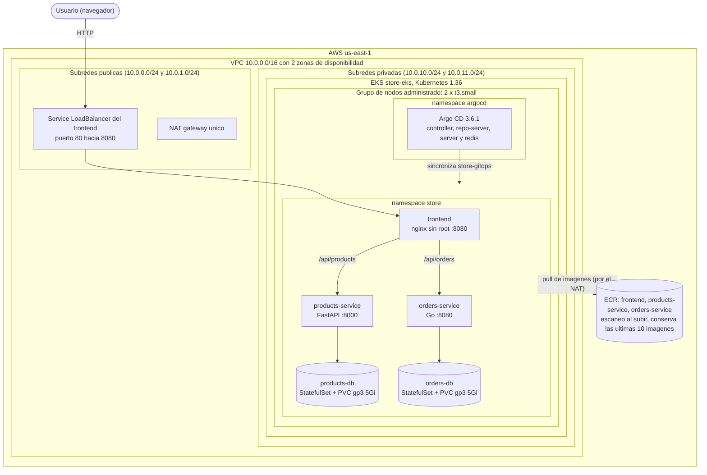
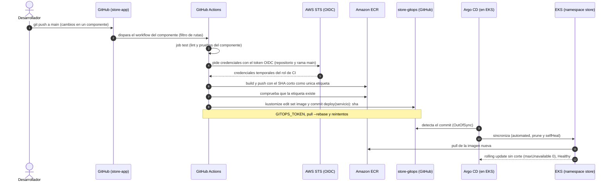
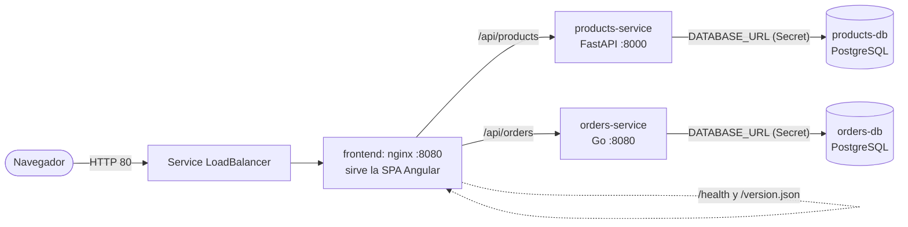

# Arquitectura de store-app

Sistema de **microservicios** (frontend Angular, `products-service` en FastAPI y `orders-service` en Go) desplegado en **AWS EKS** con **GitOps**: la infraestructura se define con Terraform, la CI publica imágenes en ECR y Argo CD sincroniza el clúster con el repositorio `store-gitops`.

> **Estado:** todo lo descrito aquí se desplegó y se verificó en AWS (v1 con el tag `0688166` y v2 de la demo con `89511da`). Al terminar la demo, **la infraestructura se destruyó** con `terraform destroy` para dejar de pagar. El código, los manifiestos y los pasos para volver a crearla siguen en los repositorios (`infra/terraform/README.md`).

Los repositorios son dos: `store-app` (código, infraestructura, CI y especificaciones) y `store-gitops` (manifiestos Kustomize y Applications de Argo CD, que es lo que vigila Argo CD).

## 1. Arquitectura en AWS

Región `us-east-1`. Todo sale de `infra/terraform/` (VPC, EKS, ECR, EBS CSI, OIDC) y de `store-gitops` (lo que corre dentro del clúster).



**Qué hay en cada capa (todo verificado en el código):**

| Capa | Detalle | Dónde se define |
|---|---|---|
| Red | VPC `10.0.0.0/16`, 2 subredes públicas y 2 privadas, **un solo NAT gateway** (ahorro de costo), etiquetas `kubernetes.io/role/elb` e `internal-elb` | `infra/terraform/vpc.tf` |
| Clúster | EKS `store-eks` (Kubernetes 1.36), nodos en subredes privadas, quien crea el clúster es administrador (access entry), endpoint público limitado a una IP | `infra/terraform/eks.tf` |
| Nodos | Grupo administrado de **2 × `t3.small`** (AL2023): 11 pods y ≈ 1,4 GiB por nodo, tipo elegido porque el plan Gratuito de AWS no permite `t3.medium` | `infra/terraform/variables.tf`, `openspec/specs/cluster-capacity/` |
| Addons | `coredns`, `kube-proxy`, `vpc-cni` y `aws-ebs-csi-driver` (con su rol IRSA); CoreDNS y el controlador EBS CSI con 1 réplica | `eks.tf`, `ebs-csi.tf` |
| Almacenamiento | StorageClass `gp3` por defecto, un PVC de 5 GiB por base de datos | `infra/terraform/argocd/storage.tf` |
| Imágenes | 3 repositorios ECR con escaneo al subir y política de ciclo de vida de 10 imágenes | `infra/terraform/ecr.tf` |
| Acceso de la CI | Proveedor OIDC de GitHub y un rol IAM que solo asume el repositorio `store-app` en la rama `main`, con permiso de push a esos 3 ECR | `infra/terraform/github-oidc.tf` |
| Argo CD | Chart oficial `argo-cd` 10.17.2 en el namespace `argocd`, reducido a 4 pods (sin `dex`, `notifications` ni ApplicationSet) | `infra/terraform/argocd/` |
| Aplicación | 5 pods en el namespace `store`, probes en `/health`, requests y limits, sin root | `store-gitops/apps/*` |

El presupuesto de capacidad (17 de 22 pods, 46 % de la memoria asignable, con 3 pods libres para el rolling update) se calcula con `scripts/check-capacity.py`.

## 2. Flujo GitOps

Del `git push` al pod nuevo, sin que nadie ejecute `kubectl apply`.



Puntos importantes del flujo (todos implementados):

- **Tag = SHA corto** (7 caracteres) y nunca `latest`: `.github/workflows/_deploy-component.yml`.
- **`APP_VERSION` = tag de la imagen**: Kustomize copia el tag al entorno del contenedor (`replacements` en `store-gitops/apps/*/kustomization.yaml`), así que la versión que muestran `/health` y el pie de la aplicación es siempre la desplegada.
- **Solo se actualiza `store-gitops` si el push a ECR salió bien** (`needs` y una comprobación con `aws ecr describe-images`).
- **Sin llaves de AWS**: el rol se asume por OIDC con un sujeto exacto (con los ids numéricos de GitHub) y expira solo (`infra/terraform/github-oidc.tf`).
- **Un solo escritor en `store-gitops`** a la vez (concurrencia) y el script reintenta con `pull --rebase` (`.github/scripts/update-gitops.sh`).

## 3. Comunicación entre componentes



- El navegador solo habla con **un origen** (nginx): sin CORS y sin URLs de servicios en el código del frontend. nginx quita el prefijo `/api` y reenvía a `products-service:8000` y `orders-service:8080` por su nombre de Service (`frontend/nginx.conf`).
- **Database-per-service:** cada servicio tiene su propia base y nunca consulta la del otro. Un pedido guarda solo `product_id` (sin clave foránea) y es el frontend quien cruza los nombres de producto.
- Las contraseñas de las bases **no están en git**: viven en Secrets de Kubernetes (`products-db-credentials` y `orders-db-credentials`) creados con `kubectl create secret`.
- El pie de la aplicación consulta `/version.json` (frontend) y `/api/products/health` y `/api/orders/health` cada 30 segundos.
- Los dos servicios exponen `GET /health` con `{status, version}`, y el frontend también, para las probes de Kubernetes.

## 4. Tecnologías y por qué

| Tecnología | Para qué se usa | Por qué se eligió |
|---|---|---|
| Angular 22 (componentes standalone) y Vitest | SPA de productos y pedidos (`frontend/`) | Pide el proyecto; standalone evita módulos y Vitest con jsdom permite probar sin navegador |
| nginx (`nginx-unprivileged`) | Sirve la SPA y hace de proxy de `/api` | Un solo origen sin CORS, imagen pequeña y sin root |
| Python 3.12, FastAPI, SQLAlchemy 2, Pydantic y psycopg 3 | `products-service` | Validación y documentación de la API con poco código; SQLAlchemy síncrono basta para este volumen |
| Go 1.25, chi y pgx | `orders-service` | Binario estático de ≈ 4 MiB en una imagen *distroless*; muestra el patrón con otro lenguaje |
| PostgreSQL 16 (StatefulSet con PVC `gp3`) | Una base por servicio | Database-per-service; en el clúster se usa un StatefulSet por simplicidad (ver pendientes) |
| Docker multi-stage | Imágenes de los 3 componentes | Imágenes finales mínimas y con usuario no root |
| `docker compose` | Todo el sistema en local sin AWS | Probar antes de gastar en la nube |
| Terraform y módulos oficiales `terraform-aws-modules` | VPC, EKS, ECR e IAM | Código declarativo y repetible; los módulos evitan reinventar redes y clústeres |
| AWS EKS (nodos administrados), VPC con un NAT, ECR, EBS CSI | Plataforma de ejecución | EKS administra el plano de control; un solo NAT y nodos pequeños mantienen el costo bajo |
| GitHub Actions con OIDC | CI: pruebas, build, push y actualización de `store-gitops` | Sin llaves de AWS estáticas: credenciales temporales y rol limitado a un repositorio y una rama |
| Kustomize (con `replacements`) | Manifiestos de `store-gitops` | La CI solo cambia el tag con `kustomize edit set image` y `APP_VERSION` lo sigue sin editar nada más |
| Argo CD (app-of-apps) | Sincronización automática con `prune` y `selfHeal` | El clúster refleja siempre lo que hay en git y revierte cambios manuales |
| OpenSpec | Desarrollo guiado por especificaciones | Cada funcionalidad nace de una propuesta revisable, con escenarios verificables |
| `AGENTS.md`, `CLAUDE.md` y harness (`feature_list.json`, `progress.md`, `init.sh`) | Reglas y estado compartidos entre agentes de IA | Que cualquier agente (Claude Code u opencode) retome el trabajo sin perder contexto |
| pytest, ruff, `go test`, ESLint, actionlint y shellcheck | Calidad | Se ejecutan en la CI y en `./init.sh` |

## 5. Desarrollo guiado por specs

Cada funcionalidad se hizo con un *change* de OpenSpec: `propose` → revisión humana → `apply` (con pruebas y evidencia) → `archive` (los requisitos pasan a `openspec/specs/`). Resultado final: **10 changes archivados** en `openspec/changes/archive/`, **21 capacidades**, **80 requisitos** y **237 escenarios** verificables en `openspec/specs/`.

| Change | Tareas | Qué definió |
|---|---|---|
| `bootstrap-harness` | 15 | El estado persistente entre sesiones: `feature_list.json`, `progress.md`, `init.sh` y la regla de leerlos al iniciar |
| `products-service-fastapi` | 17 | Catálogo de productos: `GET/POST /products`, `/health`, siembra, Dockerfile sin root y la capacidad `service-health` |
| `orders-service-go` | 17 | Pedidos en Go con `product_id` solo como referencia, migración al arrancar e imagen *distroless* |
| `frontend-angular` | 22 | Vistas de productos y pedidos, pie con las versiones de cada servicio, proxy de nginx y `docker-compose.yml` |
| `infra-aws-terraform` | 22 | VPC, EKS, 3 ECR, EBS CSI con `gp3`, OIDC de GitHub y la etapa separada de Argo CD |
| `gitops-manifests` | 17 | Manifiestos en `store-gitops`: Deployments con probes, bases como StatefulSet, `APP_VERSION` = tag y app-of-apps de Argo CD |
| `ci-github-actions` | 16 | Un workflow por componente, login por OIDC, push con SHA corto y actualización de `store-gitops` con reintentos |
| `infra-free-tier-nodes` | 21 | Ajuste al plan Gratuito: 2 × `t3.small`, 1 réplica por componente, Argo CD reducido y presupuesto de capacidad |
| `fix-oidc-immutable-subject` | 11 | Corrección de la política de confianza: GitHub emite el `sub` con ids numéricos (sujeto inmutable) |
| `demo-visible-change` | 16 | La v2 de la demo: banner, campo `category` y una migración idempotente probada contra PostgreSQL real |

Dos de estos changes **nacieron de fallos reales** durante el despliegue (el plan Gratuito de AWS no permitía `t3.medium`, y el sujeto OIDC de GitHub era el inmutable): el flujo permitió diagnosticar, proponer, corregir y dejar la decisión por escrito en lugar de parchear a mano.

Las reglas de los artefactos están en `openspec/config.yaml` y las del proyecto en `AGENTS.md`.

## 6. Pendiente o fuera de alcance

Esto **no existe** en el repositorio y se deja marcado como pendiente (no se inventa):

- **HTTPS, dominio e Ingress:** el frontend se expone con un Service `LoadBalancer` clásico, sin certificado.
- **Estado de Terraform remoto:** el estado es local (ignorado por git); falta un backend S3 con bloqueo.
- **Alta disponibilidad:** un solo NAT, una réplica por componente y CoreDNS con una réplica (decisión de costo y de capacidad).
- **Gestión de secretos:** los Secrets de las bases se crean a mano con `kubectl`; falta integrarlos con AWS Secrets Manager o un operador equivalente.
- **Bases de datos administradas y copias de seguridad:** PostgreSQL corre en StatefulSets sin *backups*; en producción se usaría RDS.
- **Observabilidad:** sin métricas, trazas ni alertas.
- **Escalado automático:** sin HPA ni autoescalado de nodos.
- **Migraciones con una herramienta dedicada:** hoy hay una migración manual e idempotente (`products-service/app/db/migrations.py`); Alembic queda pendiente.
- **Pruebas de extremo a extremo** en un navegador y varios entornos (solo existe uno).
- **Vulnerabilidades de la imagen base del frontend:** el escaneo de ECR marcó la base antigua `nginx-unprivileged:1.27-alpine`; subirla queda como mejora aparte. Tampoco hay Dependabot.

## 7. Mapa de archivos

```
store-app/
├── frontend/ products-service/ orders-service/   código, pruebas y Dockerfile de cada componente
├── infra/terraform/ (+ argocd/)                  infraestructura de AWS y Argo CD
├── .github/workflows/ (+ scripts/)               CI: un workflow por componente y uno reutilizable
├── openspec/                                     config.yaml, specs/ y changes/archive/
├── scripts/                                      check-capacity.py y test-products-migration.sh
├── docker-compose.yml                            todo el sistema en local
├── AGENTS.md / CLAUDE.md                         reglas para agentes de IA
└── feature_list.json / progress.md / init.sh     estado del proyecto entre sesiones
store-gitops/
├── apps/{frontend,products-service,orders-service,products-db,orders-db}/   manifiestos Kustomize
└── argocd/                                       Application raíz (app-of-apps) y una por componente
```
