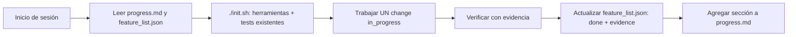

## Context

Ver `proposal.md` (Why). El repo no tiene código aún; `AGENTS.md` ya define comandos de test por componente (sección 7). La skill `harness-creator` trae plantillas en `.claude/skills/harness-creator/templates/` (`feature-list.json`, `progress.md`, `init.sh`). Esas plantillas usan `not-started` como estado y `init.sh` genérico, así que se adaptan en vez de copiarse tal cual.

## Goals / Non-Goals

**Goals**
- Estado de sesión legible por humanos y por agentes, sin depender del chat.
- Verificación de entorno que no falle por herramientas o componentes que aún no existen.

**Non-Goals**
- No crear `session-handoff.md`, benchmarks ni scripts de la skill (`create-harness.mjs`, `validate-harness.mjs`) dentro del repo.
- No instalar herramientas faltantes; solo avisar.
- No automatizar la actualización de los archivos (la hace el agente al cerrar el change).

## Decisions

1. **Archivos en la raíz de `store-app`.** Son fáciles de encontrar para cualquier agente y no se mezclan con `openspec/`. Alternativa: `docs/`, descartada porque es documentación humana, no estado.
2. **`status` = `pending | in_progress | done`.** Es lo que pidió el usuario; la plantilla `not-started` se descarta.
3. **IDs `change-0` … `change-7` con `name` igual al change de OpenSpec.** El `id` da orden estable y el `name` enlaza con `openspec/changes/<name>`. Se agrega el campo opcional `dependencies` (id previo) para que se respete el orden aprobado.
4. **Un solo `in_progress`.** Evita trabajo a medias; es regla de la skill y se verifica con un chequeo simple en `init.sh`.
5. **`init.sh` en bash, sin `set -e` global.** Debe revisar todas las herramientas aunque una falte; se acumulan faltantes y se sale con código 1 solo si fallan tests o JSON inválido. Faltar una herramienta es aviso (exit 0) porque en fase temprana es normal (p. ej. `terraform` sin instalar).
6. **Detección de componentes por existencia de carpeta/manifiesto** (`products-service/requirements.txt`, `orders-service/go.mod`, `frontend/package.json`) y comandos de `AGENTS.md` sección 7. Así no hay que editar `init.sh` al añadir cada change.
7. **Validar `feature_list.json` con `python3` o `node`** (lo que exista) en lugar de `jq`, que no está garantizado.
8. **`progress.md`: sección nueva por change, la más reciente al final** y bloque "Siguiente paso" fijo. Se prefiere append para no reescribir historia.
9. **Regla en `AGENTS.md`, no en `CLAUDE.md`.** `AGENTS.md` es la fuente única de verdad e `CLAUDE.md` lo importa.

## Risks / Trade-offs

- [Archivos desactualizados si el agente olvida cerrarlos] → regla en `AGENTS.md` y tarea explícita de cierre en cada change; `init.sh` avisa si hay más de un `in_progress`.
- [`init.sh` tarda si los tests son largos] → solo corre componentes existentes; permitir `SKIP_TESTS=1`.
- [Versiones de herramientas no se fijan] → solo se muestran; fijar versiones queda para los changes de infra y CI.
- [Rutas de nombres de archivo ya existentes con error (`gitignore`, `prompts(1).md`)] → fuera de este change; el usuario indicó que las corrigió.

## Migration Plan

No aplica (archivos nuevos). Rollback: borrar los tres archivos y revertir la regla de `AGENTS.md`.
