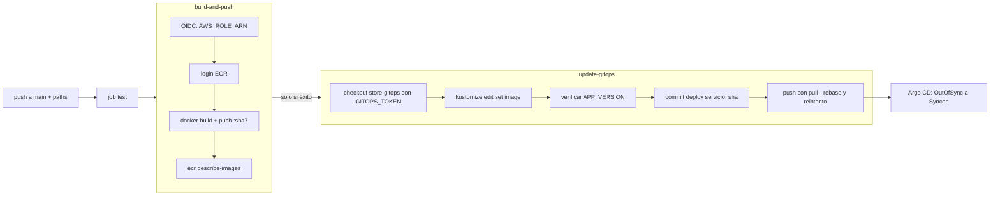

## Context

Ver `proposal.md` (Why). Piezas ya existentes que la CI usa:

- **ECR** (change de infra): repositorios `frontend`, `products-service` y `orders-service` con etiquetas mutables y escaneo al subir. **Rol OIDC** `store-eks-github-actions`: solo lo asume `repo:<dueño>/store-app:ref:refs/heads/main`; puede iniciar sesión en ECR y subir/consultar imágenes (incluye `ecr:DescribeImages`), sin permisos sobre EKS ni IAM.
- **`store-gitops`** (change anterior): `apps/<nombre>/kustomization.yaml` con bloque `images` y un `replacements` que copia el tag a `APP_VERSION`. Contrato con la CI, verificado con el CLI real: `kustomize edit set image "$NAME=$ECR_REGISTRY/$NAME:$SHORT_SHA"` cambia solo `images`.
- **Componentes**: `frontend` (acepta `ARG APP_VERSION`), `products-service` y `orders-service` (leen `APP_VERSION` del Deployment, no necesitan build-arg). Comandos de prueba de `AGENTS.md`.
- `docs/prompts.md` ya anuncia el secret `GITOPS_TOKEN` y la variable `AWS_ROLE_ARN`.

Versiones actuales de las acciones (consultadas en GitHub): `actions/checkout` v7, `setup-node` v7, `setup-python` v7, `setup-go` v7, `aws-actions/configure-aws-credentials` v6, `aws-actions/amazon-ecr-login` v2, `docker/setup-buildx-action` v4, `docker/build-push-action` v7. Kustomize 5.8.3.

## Goals / Non-Goals

**Goals**
- Push a `main` → imagen en ECR con el SHA corto → commit en `store-gitops` → Argo CD despliega, sin pasos manuales.
- Cero llaves estáticas de AWS, permisos mínimos y un token acotado.
- Lógica de gitops comprobable en local, porque los workflows solo corren en GitHub.

**Non-Goals**
- Ejecutar los workflows desde aquí, crear secrets o infraestructura.
- Entornos múltiples, aprobaciones manuales, escaneo de vulnerabilidades en CI, pruebas e2e.

## Decisiones

1. **Tres workflows por componente + uno reutilizable (`_deploy-component.yml`).** Cada archivo trae lo propio del componente (disparo y job `test`) y llama al reutilizable para `build-and-push` y `update-gitops`. Lo sensible (OIDC, push, token) queda escrito una sola vez en lugar de copiarse tres veces. El subrayado inicial marca que no se lanza solo.
2. **Disparo:** `push` a `main` con `paths: [<carpeta>/**]` y `workflow_dispatch`. Los archivos de workflow **no** están en `paths`: subir la CI no debe disparar despliegues antes de que exista la infraestructura. Una ejecución manual desde otra rama falla en OIDC porque el rol solo confía en `main`, lo que es deseable.
3. **Concurrencia:** grupo `deploy-<componente>` por workflow y, dentro del reutilizable, grupo `gitops-update` compartido por todos los `update-gitops`, ambos con `cancel-in-progress: false`. Evita carreras entre componentes que cambian en el mismo push, sin descartar despliegues.
4. **Tests antes de nada:** job `test` con los comandos de `AGENTS.md` por componente (lint o formato incluidos). `build-and-push` depende de él con `needs`.
5. **Etiqueta = 7 primeros caracteres de `github.sha`** (`${GITHUB_SHA::7}` en un paso que la deja como salida del job). Es el SHA corto que ya espera `store-gitops`. Solo se publica esa etiqueta; no existe una rama de código que cree `latest`.
6. **OIDC:** `aws-actions/configure-aws-credentials@v6` con `role-to-assume: AWS_ROLE_ARN` (variable, no secreto: un ARN no es una credencial) y `aws-region` (variable `AWS_REGION`, por defecto `us-east-1`). `id-token: write` solo en `build-and-push`; el resto de permisos es `contents: read`.
7. **Build y push** con `docker/setup-buildx-action@v4` y `docker/build-push-action@v7`: contexto = carpeta del componente, `platforms: linux/amd64` (los nodos son x86), `provenance: false` y `sbom: false` para publicar un manifiesto simple, caché de GitHub Actions. El frontend recibe `build-args: APP_VERSION=<sha7>`.
8. **Verificación del push:** `aws ecr describe-images --image-ids imageTag=<sha7>` al final de `build-and-push`; si la etiqueta no aparece, el job falla y `update-gitops` no corre. Es la forma explícita de cumplir "solo si el push a ECR salió bien", además de `needs`.
9. **`update-gitops` con `needs: build-and-push`** (éxito por defecto). Checkout de `${{ github.repository_owner }}/store-gitops` (rama `main`) con `GITOPS_TOKEN`: no se escribe el usuario a mano, así funciona en cualquier cuenta que tenga `store-app` y `store-gitops` juntas.
10. **Kustomize fijado y verificado:** se descarga el tarball de la versión 5.8.3 de `kubernetes-sigs/kustomize` y se compara su sha256 (valor escrito en el workflow, calculado durante la implementación). No se usa `curl | bash` ni acciones de terceros para instalarlo.
11. **Script `.github/scripts/update-gitops.sh`** con la lógica de gitops (edit, verificación, commit, push con reintentos). Recibe todo por variables de entorno (`COMPONENT`, `ECR_REGISTRY`, `SHORT_SHA`, `GITOPS_DIR`), así que el workflow no interpola datos en el shell y el script se prueba en local con un remoto temporal.
12. **`APP_VERSION` sin paso de edición.** Se actualiza sola porque Kustomize la copia del tag (decisión del change anterior). La CI **verifica** el resultado: `kustomize build` debe mostrar `APP_VERSION` y la imagen con el SHA nuevo; si no, falla antes del commit. Así cumple "actualizar APP_VERSION" sin una segunda edición que pudiera divergir del tag.
13. **Commit y push:** autor `github-actions[bot]`, mensaje `deploy(<servicio>): <sha7>`; si `git diff` está vacío, se termina sin error. Push con `git pull --rebase` y hasta 5 intentos con espera creciente; si el rebase choca (mismo `kustomization.yaml`), se aborta, se reinicia desde `origin/main` y se repite la edición (es idempotente), en lugar de intentar resolver el conflicto.
14. **Seguridad de datos de entrada:** ningún `${{ }}` con datos del usuario dentro de `run`; los valores pasan por `env`. `persist-credentials: false` en el checkout de `store-app`; `GITOPS_TOKEN` solo en el checkout de `store-gitops` y solo en ese job.
15. **Idioma:** nombres de jobs y steps en inglés; mensajes `echo` del script y de los pasos en español.
16. **Verificación sin GitHub:** `actionlint` (compilado con Go, versión fijada) sobre los workflows, comprobaciones de estructura con Python y una prueba local del script: remoto git temporal clonado de `store-gitops`, casos de éxito, remoto adelantado, conflicto, sin cambios, versión incorrecta y reintentos agotados.

## Riesgos / Trade-offs

- [Los workflows no se pueden ejecutar desde aquí; la primera ejecución real es del usuario] → `actionlint`, la prueba local del script y un README con una lista de comprobación del primer despliegue.
- [Si se hace push a `main` con cambios en un componente antes de aplicar la infraestructura y crear los secrets, el workflow falla en el login de AWS] → el README lo advierte y recomienda crear primero `AWS_ROLE_ARN` y `GITOPS_TOKEN`.
- [`GITOPS_TOKEN` caduca o es demasiado amplio] → se documenta un token de granularidad fina limitado a `store-gitops` y su fecha de expiración.
- [Protección de rama en `store-gitops` bloquea el push del bot] → el README explica cómo permitirlo; la prueba local no la cubre.
- [Acciones fijadas por versión mayor, no por SHA de commit] → riesgo de cadena de suministro aceptado para un proyecto académico con acciones de GitHub, AWS y Docker; el README sugiere Dependabot.
- [Ejecuciones simultáneas de componentes] → concurrencia compartida más reintentos con rebase.
- [Build del frontend lento (npm ci + Angular)] → caché de capas en GitHub Actions.
- [Reejecutar un workflow con el mismo SHA] → ECR acepta etiquetas mutables y el script termina sin commit si no hay cambios.
- [El filtro de `paths` no incluye los workflows] → para probar un cambio de CI se usa `workflow_dispatch`.

## Plan de migración

No aplica (archivos nuevos). Orden de uso: aplicar la infraestructura, crear `AWS_ROLE_ARN` y `GITOPS_TOKEN` en GitHub, hacer push de `store-app` y de `store-gitops`, y registrar la `root-app`. Rollback: borrar `.github/` y revertir los registros; `store-gitops` no se toca hasta que un workflow corre.

## Preguntas abiertas

- Ninguna que cambie los specs. El nombre del dueño del repositorio sale de `github.repository_owner`.
