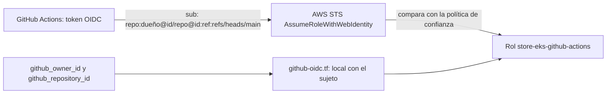

## Context

Ver `proposal.md` (Why). Hechos comprobados en solo lectura tras el fallo de los 3 workflows (runs `44225589495`, `44225593951` y `44225598166`, commit `0688166`):

- Falla `aws-actions/configure-aws-credentials@v6` con `Not authorized to perform sts:AssumeRoleWithWebIdentity`; el job `test` pasa y `update-gitops` queda `skipped`.
- `gh api repos/J0sePs/store-app/actions/oidc/customization/sub` devuelve `use_default: true`, **`use_immutable_subject: true`** y `sub_claim_prefix: repo:J0sePs@146149882/store-app@1461989222`.
- Ids reales: dueño `146149882` y repositorio `1461989222` (`gh api repos/J0sePs/store-app`).
- Política de confianza real del rol: `StringEquals` con `...:sub = repo:J0sePs/store-app:ref:refs/heads/main`, más `ForAllValues:StringEquals` para `aud` (`sts.amazonaws.com`) e `iss`. El proveedor OIDC existe con la audiencia correcta, y `AWS_ROLE_ARN` es idéntica a la salida de Terraform.
- El módulo `iam-role` v6.11.1 construye el sujeto como `repo:${subject sin "repo:"}` a partir de `oidc_subjects`, con `StringEquals`.

## Goals / Non-Goals

**Goals**
- Que el rol de CI acepte el token real de GitHub, manteniendo una igualdad exacta sin comodines y limitada a un repositorio y una rama.
- Cambiar solo la política de confianza, en el sitio y sin costo.

**Non-Goals**
- Cambiar los workflows, el proveedor OIDC o los permisos del rol sobre ECR.
- Desactivar el sujeto inmutable en GitHub.

## Decisiones

1. **Dos variables `github_owner_id` y `github_repository_id`** (`number`, por defecto `null`) con una validación de "las dos o ninguna". El `sub` inmutable de GitHub las incluye, y no se pueden deducir sin consultar la API de GitHub.
2. **Un `local` calcula el sujeto**: con los dos ids, `${owner}@${owner_id}/${repo}@${repo_id}:ref:refs/heads/${branch}`; sin ellos, el formato antiguo. Se pasa a `oidc_subjects` del módulo, que añade el prefijo `repo:` y usa `StringEquals`.
3. **Solo un formato a la vez** (no una lista con ambos). La política coincide con lo que el repositorio emite realmente y no se amplía la superficie. Si alguien cambia el ajuste en GitHub, basta con cambiar las variables. Alternativa descartada: aceptar los dos formatos, que no aporta nada porque el repositorio emite uno solo.
4. **No se desactiva el sujeto inmutable.** Con ids, un repositorio renombrado, transferido o recreado con el mismo nombre no hereda el acceso (protección contra *repo-jacking*), que es la razón de ser de ese ajuste de GitHub.
5. **Ids no secretos:** se escriben en `terraform.tfvars` (local) y en el ejemplo se usan marcadores; el comando para obtenerlos es `gh api repos/<dueño>/<repo> --jq '.id, .owner.id'` y el formato del `sub` se confirma con `gh api repos/<dueño>/<repo>/actions/oidc/customization/sub`.
6. **El plan debe mostrar una sola modificación en el sitio**: `aws_iam_role.this` del rol de CI con la política de confianza nueva. Se analiza `terraform show -json` y se detiene el proceso si aparece un reemplazo o cualquier otro cambio.
7. **Verificación real tras el `apply`:** `aws iam get-role` (política con el `sub` nuevo, un solo valor) y relanzar los 3 workflows; el paso OIDC debe pasar. Es la única prueba concluyente, porque AWS solo evalúa el token real.
8. **Documentación:** entrada de "Problemas frecuentes" para el error `Not authorized to perform sts:AssumeRoleWithWebIdentity`, con las dos comprobaciones (formato del `sub` e ids).

## Riesgos / Trade-offs

- [Ids mal copiados o repositorio recreado (id nuevo): el error vuelve a aparecer] → los comandos `gh api` del README y la comprobación posterior con el run real.
- [Quien use un repositorio con el formato antiguo y defina los ids por error] → el formato antiguo es el valor por defecto sin ids y la validación impide definir solo uno.
- [El `apply` modifica una política de confianza de IAM] → es en el sitio, sin costo y reversible; se revisa el plan antes y se verifica la política real después.
- [Reintentos del login con 12 intentos tardan más de 1 minuto en fallar] → no se cambia; el error es claro y ahora está documentado.

## Plan de migración

Orden: aplicar el código y generar `plan.tfplan` → revisar el plan (solo la política del rol) → OK del usuario → `terraform apply plan.tfplan` → comprobar la política real → relanzar los 3 workflows. Rollback: volver a la política anterior quitando los ids de `terraform.tfvars` y aplicando de nuevo.

## Preguntas abiertas

- Ninguna que cambie los specs.
