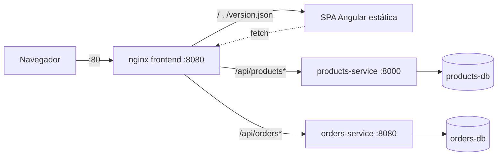

## Context

Ver `proposal.md` (Why). Ya existen `products-service` (FastAPI, puerto 8000, errores `{"detail": ...}`) y `orders-service` (Go, puerto 8080, errores `{"error": ...}`); ambos exponen `/health` en la raíz y sus rutas sin prefijo (`/products`, `/orders`). Los pedidos solo guardan `product_id`; el frontend es quien cruza ambos datos para mostrar nombres. Hay Node 24, npm 11 y Docker en la máquina; `npm view @angular/cli` devuelve la 22.2.7; las imágenes `node:22-alpine`, `nginx:1.27-alpine` y `nginxinc/nginx-unprivileged:1.27-alpine` existen. El change de demo (`demo-visible-change`) añadirá un banner y una columna "Categoría" a la tabla de productos, y el guion del video muestra las versiones nuevas en el pie de página.

## Goals / Non-Goals

**Goals**
- UI mínima y clara para ambos servicios, en español, con versiones visibles.
- Un único origen (nginx) para el navegador: sin CORS ni URLs absolutas.
- Todo el sistema arrancable en local con un comando.

**Non-Goals**
- Edición/borrado, autenticación, paginación, e2e en navegador.
- Manifiestos de Kubernetes y CI (changes siguientes).
- Cambiar los servicios (en particular, no se les añade todavía `APP_VERSION` en sus Dockerfiles).

## Decisions

1. **Angular CLI actual (22.x), standalone, CSS, sin SSR**, creado con `ng new frontend --skip-git`. Es lo que pide el proyecto y evita complejidad extra; se respeta el generador de pruebas que traiga la CLI y se usa `npm test -- --watch=false` de `AGENTS.md`.
2. **Estructura:** `src/app/core/{models,services}` (interfaces y servicios HTTP), `src/app/features/{products,orders}` con `products-page` y `orders-page`, `src/app/shared/version-footer` y `app-shell` (nav, `router-outlet`, pie). Es la convención de `AGENTS.md`.
3. **Estado con signals y servicios sin librería de estado.** Dos listas pequeñas no justifican NgRx.
4. **Formularios reactivos** con validadores iguales a los de los servicios (`name` requerido, `price` ≥ 0,01, `stock` entero ≥ 0, `quantity` entero ≥ 1, `customer` requerido). El servidor sigue siendo la autoridad; el frontend solo evita peticiones evidentemente inválidas.
5. **Rutas relativas por servicio:** `/api/products` y `/api/orders` (más `/health` de cada uno). nginx quita el prefijo `/api` y mantiene el recurso: `/api/products/1` → `products-service:8000/products/1`. Así los servicios no cambian y el frontend nunca conoce puertos.
6. **Health por el proxy** con `location = /api/products/health` y `location = /api/orders/health` (antes que los prefijos), que apuntan a `/health` del servicio. Evita que `health` se confunda con un id de producto.
7. **Normalizador de errores** (`toUserMessage`) en `core`: lee `error.error.detail` (texto), `error.error.error` (texto), trata `detail` en lista como validación genérica y convierte red/5xx en "No se pudo conectar con el servicio". Resuelve la diferencia de formato entre servicios sin tocarlos.
8. **Pedidos:** `orders-page` carga productos y pedidos en paralelo (`forkJoin`) y calcula un mapa `id → nombre` (`computed`). El selector usa la lista de productos; un `product_id` ausente se muestra como "Producto #id".
9. **Tablas con `<table>` y `<th>` por columna** para que el change de demo añada "Categoría" con un cambio local.
10. **Versiones con `VersionService`:** `timer(0, 30000)` + `switchMap` y `catchError` por origen (`/version.json`, `/api/products/health`, `/api/orders/health`), de modo que un fallo no afecte a los demás. Se consulta al cargar y cada 30 s, para que el pie cambie solo durante el rolling update del video.
11. **Versión del frontend = identidad de la imagen:** `ARG APP_VERSION=dev` en el Dockerfile genera `version.json` al construir (CI pasará el SHA). Alternativa descartada: leerla en tiempo de ejecución desde una variable de entorno, que obligaría a un script de entrada y a escribir en el sistema de archivos de un contenedor no root. El valor se valida con `^[A-Za-z0-9._-]+$` para no romper el JSON.
12. **nginx sin privilegios:** imagen `nginxinc/nginx-unprivileged:1.27-alpine` (usuario `nginx`, puerto 8080). `version.json` con `Cache-Control: no-store`, `index.html` con `no-cache`, activos con hash en caché larga, `gzip` activo y `X-Content-Type-Options: nosniff`. Fallback de SPA con `try_files $uri /index.html`.
13. **Dockerfile multi-stage:** etapa `node:22-alpine` (`npm ci`, `ng build`, `version.json`) y etapa final nginx-unprivileged con el resultado y `nginx.conf`.
14. **`docker-compose.yml`:** `postgres:16-alpine` con volumen y `healthcheck` (`pg_isready`); los servicios usan `depends_on: condition: service_healthy`; solo el frontend publica puerto (`${FRONTEND_PORT:-80}:8080`). `DATABASE_URL` se arma con variables del `.env`; las contraseñas usan `${VAR:?mensaje en español}` para fallar si faltan. `.env.example` se versiona con valores de ejemplo y `.env` queda ignorado (regla de `AGENTS.md`: ningún secret en git), a costa de un paso previo `cp .env.example .env`.
15. **Versiones en compose** con variables `FRONTEND_APP_VERSION`, `PRODUCTS_APP_VERSION` y `ORDERS_APP_VERSION` (por defecto `dev`). Los servicios ya leen `APP_VERSION` del entorno; el frontend la recibe como `build.args`.
16. **Calidad:** `angular-eslint` (`npm run lint`), TypeScript estricto y tipos explícitos para cada respuesta.

## Risks / Trade-offs

- [nginx falla al arrancar si no resuelve `products-service` u `orders-service`] → en compose `depends_on` los levanta antes; en Kubernetes el DNS de los Services existe. Se deja anotado para el change de gitops.
- [Cambios de la CLI 22 en el ejecutor de pruebas] → se usa el que genere la CLI y se documenta el comando real en el README; si exige navegador, se usa una variante headless sin tocar el contrato.
- [La imagen de los servicios aún no recibe `APP_VERSION` al construir] → fuera de alcance; en el change de CI se añadirá `ARG APP_VERSION`. Hasta entonces, en compose se pasa por entorno.
- [Puerto 80 ocupado en el host] → `FRONTEND_PORT` lo cambia.
- [Requiere `.env` antes del primer arranque] → el error de compose lo explica en español y el README lo documenta.
- [Descargar dependencias y construir lleva tiempo y red] → `npm ci` con caché de capas en el Dockerfile.
- [Sin e2e, un fallo de integración visual podría pasar] → verificación manual con `docker compose` y `curl` a través del proxy, más revisión del navegador por el usuario.

## Migration Plan

No aplica (componentes nuevos). Rollback: borrar `frontend/`, `docker-compose.yml` y `.env.example`, y revertir `feature_list.json` y `progress.md`.
