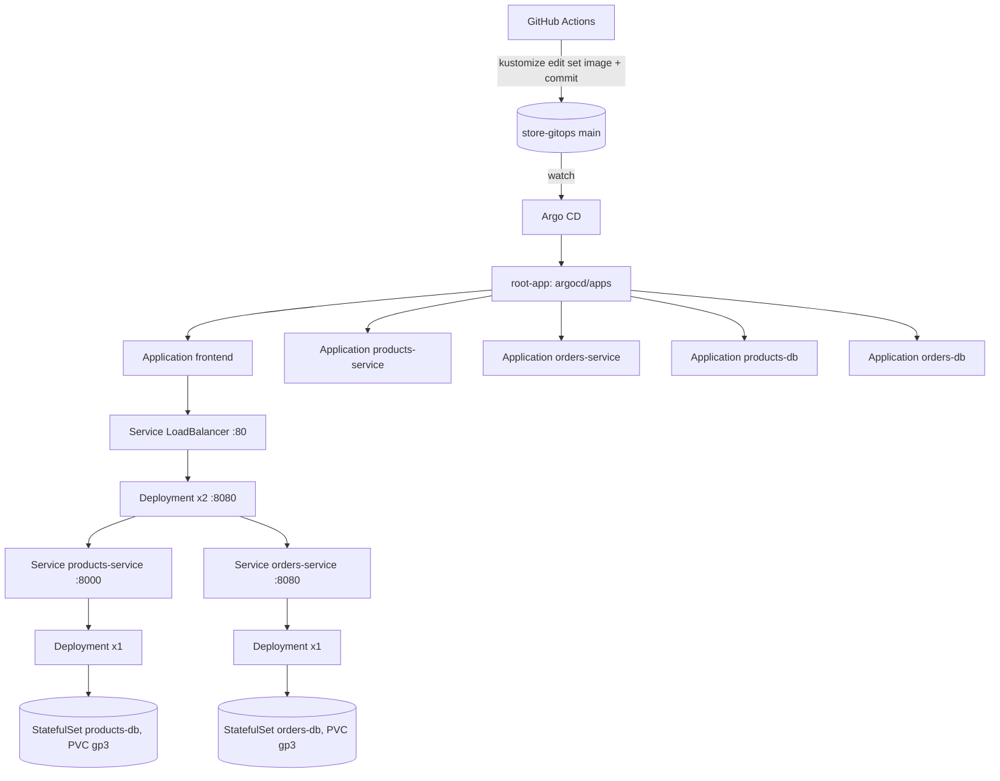

## Context

Ver `proposal.md` (Why). El destino es `../store-gitops` (repositorio git sin commits, remoto `https://github.com/J0sePs/store-gitops.git`); el resto vive en `store-app`. Datos verificados:

- Los servicios leen `DATABASE_URL` y `APP_VERSION` del entorno y exponen `/health`: `products-service` en el puerto 8000 (usuario 10001), `orders-service` en el 8080 (usuario 65532) y el frontend en el 8080 (usuario 101). El frontend **no** tiene `/health`; nginx resuelve `products-service` y `orders-service` por nombre al arrancar.
- Infra: StorageClass `gp3` por defecto (change anterior), Argo CD en el namespace `argocd`, nodos con permiso de lectura de ECR (el módulo EKS adjunta `AmazonEC2ContainerRegistryReadOnly`), 2 nodos t3.medium (~34 pods).
- `kubectl kustomize` trae Kustomize v5.8.1. Prueba hecha: un `replacements` que lee `spec.template.spec.containers.[name=…].image` con `delimiter: ":"` e `index: 1` ve la imagen **ya transformada** por `images` y copia el tag a `APP_VERSION`; al cambiar `newTag`, ambos cambian.
- `AGENTS.md`: CI hace `kustomize edit set image` y commit; nada de `kubectl apply` desde CI, `latest` ni secretos en git; namespace `store`; probes en `/health`; requests/limits; PostgreSQL como StatefulSet con PVC gp3.

## Goals / Non-Goals

**Goals**
- Manifiestos legibles y revisables sin clúster, que Argo CD sincroniza solo.
- `APP_VERSION` siempre igual al tag desplegado, para el video de la demo.
- Cero secretos en git.

**Non-Goals**
- Workflows de CI, `kubectl apply` real, HTTPS, dominio, Ingress, HPA, backups de las bases.
- Varios entornos (overlays): hay uno solo.

## Decisiones

1. **Un `kustomization.yaml` por componente** en `apps/<nombre>/` (un solo entorno, sin overlays), con `namespace: store`. Es lo que pide el prompt y es lo que la CI edita; los overlays solo añadirían archivos.
2. **Etiquetas explícitas en cada manifiesto** (`app.kubernetes.io/name`, `app.kubernetes.io/part-of: store`) en lugar de `commonLabels`, que cambia los selectores (inmutables) y está en desuso.
3. **Imágenes por nombre lógico + `images`:** el Deployment usa `image: frontend` (o `products-service`, `orders-service`) y el `kustomization.yaml` define `newName` (repositorio ECR) y `newTag`. Es el formato que modifica `kustomize edit set image <nombre>=<url>:<tag>`, que ya fijaron `AGENTS.md` y el change de CI.
4. **Marcadores de imagen:** `000000000000.dkr.ecr.us-east-1.amazonaws.com/<nombre>` con tag `0000000`. No se escribe la cuenta real (la CI reemplaza todo) y el manifiesto sigue siendo válido. Hasta la primera ejecución de CI los pods quedan en `ImagePullBackOff`, y es lo esperado.
5. **`APP_VERSION` con `replacements`** que copia el tag desde `image` al `env` (probado). Evita una segunda edición en CI y no puede divergir del tag. Alternativas descartadas: `configMapGenerator` (CI tendría que editar dos cosas) y `vars` (en desuso).
6. **Deployments:** `RollingUpdate` con `maxSurge: 1` y `maxUnavailable: 0` (el pod nuevo entra antes de retirar el viejo); réplicas: frontend 2 (se ve el rolling update en el video) y servicios 1, porque al primer arranque dos instancias crearían a la vez la tabla y la siembra. Recursos: frontend 50m/64Mi → 250m/128Mi; `products-service` 100m/128Mi → 500m/256Mi; `orders-service` 50m/32Mi → 250m/128Mi.
7. **Probes HTTP en `/health`** (readiness: inicio 5 s y periodo 10 s; liveness: inicio 20 s y periodo 20 s). `/health` de los servicios no consulta la base, así que un fallo de la base no reinicia en bucle a los servicios.
8. **`securityContext`:** `runAsNonRoot: true` con el uid numérico de cada imagen (10001, 65532 y 101), `allowPrivilegeEscalation: false`, `capabilities.drop: [ALL]` y `seccompProfile: RuntimeDefault`. No se activa `readOnlyRootFilesystem` porque nginx escribe en `/tmp` y `/var/cache`.
9. **`/health` en el frontend (cambio en `store-app`):** el Dockerfile genera `health.json` junto a `version.json` (`{"status":"ok","version":"<APP_VERSION>"}`) y `nginx.conf` expone `location = /health` con un `rewrite` a ese archivo, `no-store`. Es la única forma de cumplir "probes en `/health`" y `GET /health` para todo servicio sin probar la SPA completa.
10. **Services:** `frontend` tipo `LoadBalancer` (80 → 8080, sin anotaciones: el controlador de nube de EKS crea el balanceador clásico, suficiente para la demo); `products-service` (8000) y `orders-service` (8080) `ClusterIP` con esos nombres exactos.
11. **PostgreSQL:** `StatefulSet` `postgres:16-alpine`, una réplica, `volumeClaimTemplates` `gp3` de 5 GiB, `PGDATA=/var/lib/postgresql/data/pgdata` (el volumen EBS trae `lost+found`), `runAsUser`/`fsGroup` 70 (usuario `postgres` de la imagen alpine), sondas `exec` con `pg_isready`, recursos 100m/256Mi → 500m/512Mi y Service headless con el nombre del StatefulSet. `POSTGRES_USER` y `POSTGRES_DB` son literales (no secretos).
12. **Secrets creados a mano:** `products-db-credentials` y `orders-db-credentials`, cada uno con `POSTGRES_PASSWORD` y `DATABASE_URL`. El servicio solo conoce `DATABASE_URL` completa, así que el Secret la trae armada; la contraseña se genera con `openssl rand -hex 16` (segura para URL). Nada de esto entra a git.
13. **Argo CD:** `argocd/root-app.yaml` (carpeta `argocd/apps`, destino namespace `argocd`) y una Application por componente en `argocd/apps/` (origen `apps/<nombre>`, rama `main`, destino `https://kubernetes.default.svc` y namespace `store`), con `automated` (`prune` y `selfHeal`), `CreateNamespace=true` y finalizador `resources-finalizer.argocd.argoproj.io`. Sin sync-waves: los servicios reintentan la conexión y Kubernetes los reinicia hasta que la base responde.
14. **`repoURL` `https://github.com/J0sePs/store-gitops.git`:** es el remoto ya configurado en `../store-gitops`; si cambia, hay 6 archivos que editar (el README lo indica).
15. **Verificación sin clúster:** `kubectl kustomize apps/<x>` de los cinco componentes y comprobaciones estáticas con Python (`yaml` del venv de `products-service`) sobre los manifiestos construidos; prueba de `APP_VERSION` cambiando `newTag` en una copia en el directorio temporal. No se ejecuta ningún `kubectl apply`.
16. **Dos repositorios, dos commits:** `store-gitops` (contenido nuevo) y `store-app` (spec, `/health` del frontend, registros). Los hace el humano; `git push` solo con confirmación.

## Riesgos / Trade-offs

- [Primer sync con pods en `ImagePullBackOff` y `CreateContainerConfigError`] → esperado hasta que existan los Secrets y la CI publique la primera imagen; el README explica el orden.
- [Secret creado después del namespace pero antes de la `root-app`] → el README fija ese orden; si falta, el pod reintenta solo.
- [Los volúmenes EBS están atados a una zona: la base solo puede reprogramarse en nodos de esa zona] → con 2 nodos repartidos en 2 zonas es suficiente para la demo; se documenta.
- [Una réplica por servicio: un reinicio causa un corte breve] → aceptable; el frontend con 2 réplicas sigue sirviendo la SPA.
- [El balanceador clásico del controlador en árbol] → funciona para la demo; migrar a NLB/Ingress queda fuera de alcance.
- [`replacements` depende de que la imagen sea `repositorio:tag`] → es el formato de `kustomize edit set image`; con `digest` no funcionaría y se anota en el README.
- [Capacidad: ~34 pods entre kube-system, EBS CSI, Argo CD y la aplicación (≈10 pods propios)] → hay margen; si falta, se sube el número de nodos en Terraform.
- [Cambiar `/health` del frontend toca `store-app`] → cambio pequeño con prueba de contenedor y spec propio.

## Plan de migración

No aplica (contenido nuevo). Después de revisar y hacer commit y push de `store-gitops`, el humano sigue el README: namespace y Secrets, `kubectl apply -f argocd/root-app.yaml`. Rollback: `git revert` del commit en `store-gitops` (Argo CD sincroniza solo) o borrar las Applications (el finalizador elimina sus recursos).

## Preguntas abiertas

- Ninguna que cambie los specs. Si el repositorio de GitOps se llama distinto, solo cambia `repoURL`.
