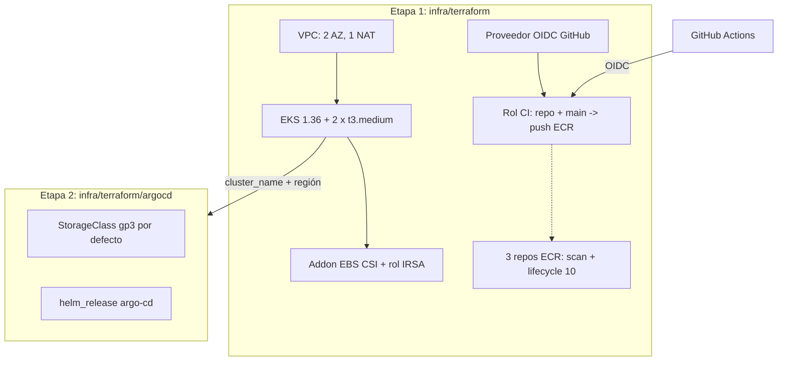

## Context

Ver `proposal.md` (Why). `openspec/config.yaml` fija: región `us-east-1`, VPC con un solo NAT, EKS con 2 × t3.medium, 3 ECR, addon EBS CSI, StorageClass gp3, proveedor OIDC de GitHub con su rol y Argo CD por `helm_release` en una etapa aparte. `AGENTS.md` exige módulos oficiales `terraform-aws-modules`, `default_tags` con `Project = "store"`, variables con `description`, OIDC (sin llaves estáticas) y que `terraform apply/destroy` solo se ejecuten con confirmación humana.

Estado verificado en solo lectura: Terraform 1.14.5 y credenciales de AWS disponibles (región `us-east-1`). Versiones en el registro: módulos `vpc` 6.8.0, `eks` 21.30.2, `ecr` 3.2.1, `iam` 6.11.1; proveedores `aws` 6.73.0, `helm` 3.3.0, `kubernetes` 3.5.0. EKS en `us-east-1` soporta Kubernetes 1.34 a 1.37 (la 1.34 termina soporte estándar el 2026-12-01). El módulo `eks` v21 acepta `addons` con `service_account_role_arn` y `pod_identity_association`, y `endpoint_public_access_cidrs`; el módulo `iam` v6 trae `iam-oidc-provider`, `iam-role` (con `enable_github_oidc`) e `iam-role-for-service-accounts`.

## Goals / Non-Goals

**Goals**
- Infraestructura repetible, barata y destruible, en dos etapas con estado separado.
- Sin llaves estáticas ni secretos en git; permisos mínimos para CI.

**Non-Goals**
- Backend remoto del estado (S3 + bloqueo), alta disponibilidad de NAT, dominio, HTTPS, observabilidad.
- Manifiestos de la aplicación (`gitops-manifests`) y workflows (`ci-github-actions`).
- Ejecutar `apply`, `destroy` o `plan` contra AWS en este change.

## Decisiones

1. **Dos carpetas con estados independientes** (`infra/terraform` y `infra/terraform/argocd`). Los proveedores `helm` y `kubernetes` necesitan un clúster existente; separarlos evita configurar proveedores con recursos que se crean en el mismo `apply`, y permite destruir Argo CD sin tocar la red.
2. **La etapa 2 lee el clúster con `data.aws_eks_cluster` y `cluster_name`/región como variables**, no con `terraform_remote_state`. Así no depende de la ubicación del estado de la etapa 1 y los valores por defecto coinciden con los de la etapa 1.
3. **Autenticación de `helm`/`kubernetes` con `exec` (`aws eks get-token`)**: los tokens no caducan a mitad del `apply` ni quedan en el estado.
4. **VPC `terraform-aws-modules/vpc/aws` 6.8.0:** 2 AZ, CIDR `10.0.0.0/16`, `single_nat_gateway = true`, `enable_nat_gateway = true`, DNS habilitado y etiquetas `kubernetes.io/role/elb` e `internal-elb`. Un NAT es lo que pide la configuración y es la mayor economía; el riesgo (caída de una AZ) es aceptable.
5. **EKS `terraform-aws-modules/eks/aws` 21.30.2, Kubernetes `1.36` por defecto** (variable). Está en soporte estándar hasta 2027-08, a diferencia de la 1.34; no se usa la 1.37 para evitar la versión más reciente sin margen de compatibilidad con el chart de Argo CD.
6. **Nodos:** un grupo administrado `AL2023_x86_64_STANDARD`, `t3.medium`, `min = desired = max = 2` (variables), en subredes privadas. Dos nodos t3.medium admiten unos 34 pods en total; con kube-system, EBS CSI, Argo CD y la aplicación alcanzan, pero con poco margen.
7. **Acceso:** `enable_cluster_creator_admin_permissions = true` (entrada de acceso para quien aplica) y `endpoint_public_access_cidrs` por variable (por defecto `0.0.0.0/0`, con recomendación en el README de limitarlo a la IP propia). Alternativa descartada: endpoint solo privado, porque exigiría una VPN o bastión.
8. **ECR con el módulo `terraform-aws-modules/ecr/aws` 3.2.1**, un `for_each` sobre `ecr_repository_names`: `repository_image_scan_on_push = true`, `repository_force_delete = true` (para que `destroy` funcione con imágenes) y política de ciclo de vida `imageCountMoreThan = 10` con `tagStatus = any`. **Etiquetas mutables**: el módulo usa inmutables por defecto, pero un fallo de CI seguido de reintento con el mismo SHA se rechazaría; la prohibición de `latest` se aplica en CI.
9. **Addon EBS CSI con IRSA:** rol creado con `iam-role-for-service-accounts` (`attach_ebs_csi_policy = true`) para `kube-system:ebs-csi-controller-sa`, enlazado con `service_account_role_arn` en un recurso `aws_eks_addon` aparte, con `depends_on` del módulo EKS (nodos incluidos). No va en el mapa `addons` del módulo porque el rol IRSA necesita el proveedor OIDC que crea el propio módulo: dentro del módulo habría una dependencia circular. Se elige IRSA sobre Pod Identity porque es la ruta documentada del módulo y no requiere el agente adicional. Los addons base (`coredns`, `kube-proxy`, `vpc-cni`) sí van en el mapa `addons` del módulo.
10. **StorageClass `gp3` en la etapa 2** (`kubernetes_storage_class_v1`: `ebs.csi.aws.com`, `type = gp3`, `WaitForFirstConsumer`, `allowVolumeExpansion`, por defecto) y `kubernetes_annotations` para quitar la marca de predeterminada a `gp2`. Está allí porque requiere un clúster vivo; ponerla en la etapa 1 obligaría a configurar el proveedor `kubernetes` con recursos del mismo `apply`. Es una desviación de ubicación respecto al orden de la lista del prompt, no de resultado.
11. **OIDC de GitHub con `iam-oidc-provider`** (URL `https://token.actions.githubusercontent.com`, audiencia `sts.amazonaws.com`) y `create_github_oidc_provider` (por defecto `true`) para reutilizar uno existente: AWS admite un solo proveedor por URL y cuenta.
12. **Rol de CI con `iam-role` (`enable_github_oidc = true`)** y sujeto exacto `repo:<github_owner>/<github_repository>:ref:refs/heads/<github_branch>` (por defecto `store-app` y `main`), sin comodines. La política en línea permite `ecr:GetAuthorizationToken` sobre `*` (no admite recurso) y las acciones de subida y consulta solo sobre los ARN de los tres repositorios. El rol no toca EKS: Argo CD sincroniza desde `store-gitops`, y CI actualiza ese repo con un token propio.
13. **`github_owner` sin valor por defecto**, para que el usuario lo indique en `terraform.tfvars`. El ejemplo usa un marcador, no el usuario real.
14. **Argo CD con `helm_release`:** repositorio `https://argoproj.github.io/argo-helm`, chart `argo-cd`, `create_namespace = true` en `argocd`, versión del chart fijada por variable, `server.service.type = ClusterIP` (sin balanceador; acceso con `kubectl port-forward`), `atomic`/`wait` activos y tiempo de espera ampliado. La contraseña inicial se lee del Secret `argocd-initial-admin-secret` y nunca sale en `outputs`.
15. **Estado local** (`*.tfstate` ignorado por git). Lo simple basta para un proyecto académico de un solo operador; el riesgo está en la sección siguiente.
16. **Versiones fijadas:** `required_version`, `required_providers` y cada `module` con versión exacta; `.terraform.lock.hcl` se versiona.
17. **`default_tags = { Project = "store" }`**, recursos y variables en inglés, comentarios en español y salidas `cluster_name`, `ecr_repository_urls` y `github_actions_role_arn`.
18. **Verificación sin tocar AWS:** `terraform fmt -check -recursive` y `terraform validate` (con `init -backend=false`) en ambas etapas, más búsquedas estáticas (sujeto OIDC exacto, ausencia de llaves, etiquetas, versiones). `terraform plan` queda fuera de este change por indicación del usuario.

## Riesgos / Trade-offs

- [Estado local: pérdida o corrupción deja recursos huérfanos] → el README recomienda no borrar `terraform.tfstate`; un backend S3 queda para un change futuro.
- [Un solo NAT y dos nodos: sin alta disponibilidad] → decisión de costo, documentada.
- [Costo continuo mientras el clúster existe (~0,25 USD/h)] → README con costos y recordatorio de `destroy` al terminar.
- [Los Services `LoadBalancer` y los PVC dejan balanceadores y volúmenes huérfanos que bloquean el borrado de la VPC] → advertencia destacada y comandos `kubectl` previos al `destroy`.
- [Poca capacidad de pods en 2 × t3.medium] → documentado; si falta, se sube `node_desired_size` o el tipo de instancia por variable.
- [Endpoint público abierto por defecto] → variable de CIDR y recomendación en el README.
- [Cuenta con proveedor OIDC de GitHub existente: el `apply` falla por duplicado] → `create_github_oidc_provider = false`.
- [Los nombres de repositorio ECR no están prefijados y podrían chocar en una cuenta compartida] → se acepta; son los nombres que pide el proyecto y se pueden cambiar por `ecr_repository_names`.
- [Cambios de API en módulos mayores recientes (EKS 21, IAM 6, VPC 6)] → versiones exactas y `terraform validate` verifican los argumentos; el `plan` real lo valida el usuario antes del `apply`.

## Plan de migración

No aplica (infraestructura nueva). Orden de uso: `apply` de `infra/terraform`, `aws eks update-kubeconfig`, `apply` de `infra/terraform/argocd`. Orden de baja: borrar Services `LoadBalancer` y PVC, `destroy` de la etapa 2 y luego de la etapa 1. Rollback del código: borrar `infra/` y revertir `feature_list.json` y `progress.md`.

## Preguntas abiertas

- Ninguna que cambie los specs. El nombre del usuario de GitHub lo aporta el humano en `terraform.tfvars`.
