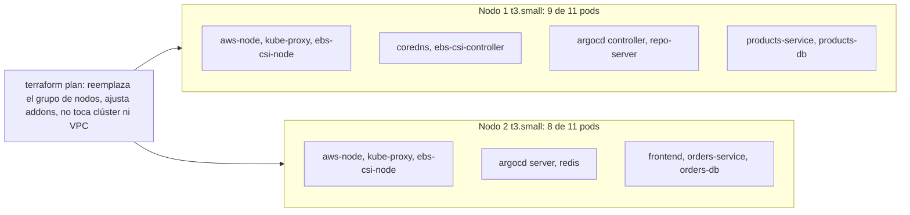

## Context

Ver `proposal.md` (Why). Estado real comprobado en solo lectura tras el `apply` parcial:

- Cuenta en el plan **Gratuito** (`accountPlanType: FREE`, 129,60 USD de crédito). Instancias elegibles en `us-east-1`: `t3.micro`, `t3.small`, `t4g.micro`, `t4g.small`, `t8i.micro`, `t8i.small`, `c7i-flex.large` y `m7i-flex.large`. `t3.medium` no lo es.
- Clúster `store-eks` ACTIVE (Kubernetes 1.36); grupo de nodos en `CREATE_FAILED` (`AsgInstanceLaunchFailures`); en el estado de Terraform existen el clúster, la VPC, los 3 ECR, los roles (EBS CSI y CI) y el addon `vpc-cni`. Faltan `coredns`, `kube-proxy` y `aws-ebs-csi-driver`, que esperan nodos. El clúster sin nodos cuesta ≈ 0,16 USD/h.
- `t3.small`: 2 vCPU, 2 GiB, 3 interfaces × 4 IPs, es decir `3 × (4 − 1) + 2 = 11` pods por nodo; con la reserva de `kubelet` quedan ≈ 1,4 GiB asignables (≈ 1 434 MiB).
- Esquemas de addons (verificados con `aws eks describe-addon-configuration`): `coredns` admite `replicaCount` y `resources`; `aws-ebs-csi-driver` admite `controller.replicaCount`, `controller.resources` y `node.resources`.
- Chart `argo-cd` 10.17.2 (`values.yaml` revisado): `dex.enabled` y `notifications.enabled` valen `true` por defecto; `applicationSet` **no** tiene `enabled`, solo `replicas`; todos los `resources` están vacíos; `redisSecretInit` crea un Job que termina.
- Valores actuales de `store-gitops`: frontend 2 réplicas, 64Mi; `products-service` 128Mi; `orders-service` 32Mi; bases 256Mi.

## Goals / Non-Goals

**Goals**
- Todo el sistema en 2 × `t3.small`, con al menos 3 pods libres para el rolling update de la demo.
- Cambiar solo el grupo de nodos y los addons en Terraform, sin recrear el clúster ni la VPC.
- Presupuesto de pods y memoria calculado, comprobable y documentado.

**Non-Goals**
- Cambiar de plan de AWS, de tipo de instancia (`c7i-flex`, `m7i-flex`) o activar *prefix delegation* del CNI.
- Aplicar nada en AWS (`terraform apply` lo ejecuta el usuario) ni subir `store-gitops` a GitHub.

## Decisiones

1. **`t3.small` como valor por defecto** (`node_instance_types`), con mínimo, deseado y máximo en 2. Es lo que el usuario eligió entre las instancias elegibles. Una cuenta de pago puede volver a `t3.medium` con una línea en `terraform.tfvars`. Alternativas descartadas: `c7i-flex.large` (más holgada, ≈ 0,33 USD/h en total), pasar a plan de pago, y *prefix delegation* del CNI (subiría el máximo de pods, pero la memoria de 1,4 GiB por nodo seguiría siendo el límite real y exige cambiar el arranque de los nodos).
2. **Cambio solo en nodos y addons.** Cambiar `instance_types` reemplaza el grupo de nodos, que ya está en `CREATE_FAILED` y marcado para reemplazo; el clúster y la VPC no dependen de él. El plan se revisa con `terraform show -json` y **se detiene todo** si aparece un `delete` o `replace` de `aws_eks_cluster`, `aws_vpc`, `aws_nat_gateway` o las subredes.
3. **Addons con una réplica:** `coredns` con `{"replicaCount": 1}` dentro del mapa `addons` del módulo EKS, y `aws-ebs-csi-driver` con `{"controller": {"replicaCount": 1}}` en el `aws_eks_addon` aparte (ver `ebs-csi.tf`). Cada uno ahorra un pod y unos 70 a 240 MiB de memoria solicitada. El coste es perder la redundancia de DNS y del controlador: se acepta en una demo.
4. **Argo CD con 4 pods:** `dex.enabled: false`, `notifications.enabled: false` y `applicationSet.replicas: 0` (el chart no permite desactivarlo de otra forma), 1 réplica explícita en controlador, repo-server y server, y estos recursos:

   | Componente | requests (CPU / memoria) | limits (CPU / memoria) |
   |---|---|---|
   | application-controller | 100m / 192Mi | 500m / 384Mi |
   | repo-server | 50m / 96Mi | 300m / 256Mi |
   | server | 50m / 64Mi | 200m / 192Mi |
   | redis | 25m / 32Mi | 100m / 64Mi |

   Los valores viven en `infra/terraform/argocd/values.yaml` y el `helm_release` los carga con `file()`: así el script de capacidad y `helm template` leen exactamente lo que se aplicará.
5. **Aplicación:** 1 réplica por Deployment, estrategia `RollingUpdate` con `maxSurge: 1` y `maxUnavailable: 0` (con una sola réplica, el pod nuevo entra antes de retirar el viejo; requiere el pod extra del presupuesto). Recursos (CPU / memoria; requests → limits):

   | Componente | requests | limits |
   |---|---|---|
   | frontend | 25m / 32Mi | 100m / 64Mi |
   | products-service | 50m / 96Mi | 300m / 192Mi |
   | orders-service | 25m / 32Mi | 150m / 64Mi |
   | products-db, orders-db | 50m / 128Mi | 300m / 256Mi |

   Los límites se confirman midiendo el consumo real en Docker antes de darlos por buenos.
6. **PostgreSQL con `shared_buffers=32MB` y `max_connections=20`** (`args: ["postgres", "-c", ...]`; hay que repetir `postgres` porque `args` reemplaza el `CMD` de la imagen). Con los valores por defecto (128 MB de búfer) la base consumiría más que el `request` de 128Mi.
7. **`values.yaml` único para Argo CD y script de capacidad** `scripts/check-capacity.py`: lee los manifiestos (`kubectl kustomize`), renderiza el chart con `helm template` (helm compilado con Go en el directorio temporal, versión fijada) y suma pods y memoria, junto con los valores estimados de los addons (constantes documentadas). Falla si queda menos de 3 pods libres o si los `requests` superan el 70 % de la memoria asignable.
8. **Plan revisado automáticamente:** `terraform plan -out=plan.tfplan` y un análisis de `terraform show -json plan.tfplan` que clasifica las acciones por recurso. El archivo del plan se llama `plan.tfplan` para que `.gitignore` lo cubra.
9. **Commits:** los cambios de `../store-gitops` se dejan en commit **local** (autorizado explícitamente por el usuario), sin push. Los de `store-app` quedan sin commit para que los revise el usuario, como en los demás changes.
10. **`openspec/config.yaml`:** además de actualizar el texto de la infraestructura, se corrige el error de YAML de `rules.specs[1]` (un `: ` sin comillas), que hacía que el CLI ignorara las reglas de specs.

### Presupuesto de pods (régimen estable) frente a 2 × 11 = 22

| Grupo | Pods | Detalle |
|---|---|---|
| DaemonSets (1 por nodo × 2) | 6 | `aws-node`, `kube-proxy`, `ebs-csi-node` |
| kube-system | 2 | `coredns` (1), `ebs-csi-controller` (1) |
| Argo CD | 4 | controlador, repo-server, server, redis |
| Aplicación | 5 | frontend, `products-service`, `orders-service`, `products-db`, `orders-db` |
| **Total** | **17** | **5 libres de 22** |

Con el rolling update de frontend y `products-service` a la vez hay 2 pods extra (19) y siguen libres 3. Un ejemplo de reparto posible: nodo 1 con 9 pods (`products-service` y `products-db` incluidos) y nodo 2 con 8 pods. El *scheduler* decide el reparto real, y las bases quedan atadas a la zona de su volumen EBS. El Job `redis-secret-init` de Argo CD termina y no ocupa pod.

### Presupuesto de memoria (requests) frente a la memoria asignable

| Grupo | MiB |
|---|---|
| Sistema (medido tras el `apply`): `coredns` 70, `ebs-csi-controller` 232, `ebs-csi-node` 104 × 2 | 510 |
| Argo CD: 192 + 96 + 64 + 32 | 384 |
| Aplicación: 128 × 2 + 96 + 32 + 32 | 416 |
| **Total solicitado** | **1 310** |
| Asignable total (2 × 1 433, medido) | 2 866 |
| Uso de la memoria asignable | 46 % (tope fijado: 70 %) |

Los `requests` de `aws-node` y `kube-proxy` no tienen memoria. Tras el `apply` se midieron en el clúster real los valores de los addons (la estimación inicial era 550 MiB para el sistema y 1 350 MiB en total, algo conservadora) y la capacidad asignable de cada nodo: 11 pods, 1930m de CPU y 1 433 MiB.

### Costo estimado por hora (aproximado, `us-east-1`)

| Componente | USD/h |
|---|---|
| Plano de control EKS | 0,100 |
| 2 × `t3.small` (0,0208 cada uno) | 0,042 |
| NAT gateway | 0,045 |
| IPv4 pública del NAT | 0,005 |
| Volúmenes (nodos y 2 PVC), KMS y logs | ≈ 0,007 |
| **Total sin balanceadores** | **≈ 0,20** |
| Con el balanceador del frontend (≈ 0,03) | ≈ 0,23 (≈ 5,5 USD/día) |

Con 129,60 USD de crédito: unos 23 días encendido.

## Riesgos / Trade-offs

- [Los `t3` usan CPU con créditos (burstable) y, por defecto, créditos `unlimited` que pueden cobrar un recargo si el uso sostenido supera la base del 20 %] → carga baja esperada; se documenta y se revisa `CPUSurplusCreditBalance` si el costo sube.
- [Poca memoria por nodo: una presión de memoria provocaría desalojos] → presupuesto al 47 % de lo asignable, límites medidos en Docker y tope del 70 % en el script.
- [CoreDNS y el controlador EBS CSI con una réplica] → sin redundancia; aceptable para la demo y fácil de revertir subiendo `replicaCount`.
- [Los valores de los addons del script son estimaciones] → se confirman tras el `apply` con `kubectl describe node` y se corrigen las constantes si difieren.
- [Una réplica por Deployment: un reinicio causa un corte breve] → `maxUnavailable: 0` evita cortes durante las actualizaciones; el pod extra del rolling update está dentro del presupuesto.
- [PVC atados a una zona: las dos bases pueden caer en el mismo nodo] → cabe en el límite de 11 pods.
- [Si el plan muestra un replace del clúster o de la VPC] → se detiene el proceso y se avisa al usuario; no se genera nada más.
- [Cambiar `values` de Argo CD tras instalarlo reinicia sus pods] → la etapa de Argo CD aún no se ha aplicado, así que no hay migración.
- [El plan Gratuito puede limitar otros servicios] → el clúster, la VPC, el NAT y los ECR ya se crearon correctamente; si algo más falla se reporta.

## Plan de migración

El estado real de AWS no cambia en este change. Orden de uso (lo ejecuta el usuario): revisar `plan.tfplan` → `terraform apply plan.tfplan` en `infra/terraform` (reemplaza el grupo de nodos, crea los addons pendientes) → `aws eks update-kubeconfig` y `kubectl get nodes` → etapa `infra/terraform/argocd` (plan y apply) → Secrets y `root-app`. Rollback del código: revertir el commit de `store-app` y el commit local de `store-gitops`.

## Preguntas abiertas

- Ninguna que cambie los specs. Las constantes de los addons del script se confirmarán con datos reales tras el `apply`.
