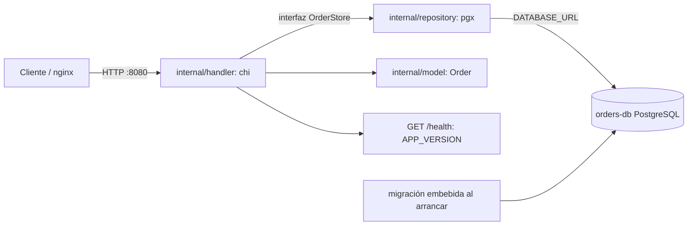

## Context

Ver `proposal.md` (Why). `orders-service/` no existe; `products-service/` ya fija el patrón (health, configuración por entorno, Dockerfile no root, tests herméticos). `AGENTS.md` pide layout `cmd/server` e `internal/{handler,repository,model,config}`, errores envueltos con `fmt.Errorf("...: %w", err)` y tests con `httptest`. Go 1.27.4 está instalado en la máquina; Docker está disponible y no hay PostgreSQL local. Las imágenes `golang:1.25-alpine` y `gcr.io/distroless/static-debian12:nonroot` existen en los registros.

## Goals / Non-Goals

**Goals**
- API mínima de pedidos y `GET /health`, con configuración solo por entorno.
- Capa HTTP testeable sin base de datos (interfaz de repositorio).
- Binario estático en imagen distroless no root.

**Non-Goals**
- Validar `product_id` contra `products-service` o su BD (database-per-service).
- Actualizar/cancelar pedidos, paginación, autenticación.
- Herramientas de migración externas (golang-migrate, goose).
- Manifiestos de Kubernetes y `docker-compose.yml`.

## Decisions

1. **Layout `cmd/server/main.go` + `internal/{config,handler,model,repository}`.** Es la convención de `AGENTS.md`.
2. **Módulo `orders-service`, `go 1.25` en `go.mod`.** Coincide con la imagen de build. `pgx/v5` y sus dependencias (`x/sync`, `x/text`) exigen Go 1.25 en `go.mod`, por eso no se usa 1.24; el toolchain local (1.27) compila módulos 1.25 sin problema.
3. **chi v5 para rutas y `pgx/v5` con `pgxpool`.** Lo pide el proyecto; `pgxpool` gestiona conexiones y reintentos sin ORM.
4. **El handler depende de una interfaz `OrderStore` (`List`, `Get`, `Create`)** definida donde se consume. Los tests usan un fake en memoria con `httptest`; el repositorio real se prueba contra PostgreSQL en Docker (tarea de verificación), no en la suite automática.
5. **Migración: SQL embebido con `//go:embed` y `CREATE TABLE IF NOT EXISTS orders (...)`** ejecutado al arrancar dentro de una sola sentencia. Es idempotente y no borra datos; una herramienta de migraciones sería excesiva para una tabla.
6. **Tabla `orders`:** `id BIGSERIAL PRIMARY KEY`, `product_id BIGINT NOT NULL`, `quantity INTEGER NOT NULL CHECK (quantity > 0)`, `customer TEXT NOT NULL`, `status TEXT NOT NULL DEFAULT 'pending'`, `created_at TIMESTAMPTZ NOT NULL DEFAULT now()`. Sin clave foránea: `product_id` es solo una referencia.
7. **`status` lo fija el servidor en `pending`**; el struct de entrada no tiene ese campo, así que se ignora si el cliente lo manda. Los demás estados quedan para un change futuro.
8. **Validación en el handler** con `json.Decoder` y `DisallowUnknownFields` desactivado (se ignora `status` sin fallar). Reglas: `product_id > 0`, `quantity > 0`, `customer` sin espacios sobrantes no vacío. Errores 400 con `{"error": "<mensaje>"}`.
9. **Formato de error `{"error": "..."}`** (idiomático en Go). `products-service` usa `{"detail": ...}`; la diferencia se documenta y el frontend deberá leer ambos campos.
10. **Listas siempre como `[]`**: se inicializa el slice vacío para no serializar `null`.
11. **`config.Load()` lee `DATABASE_URL` y `APP_VERSION` (por defecto `dev`)** y devuelve error en español si falta `DATABASE_URL`; `main` lo registra y sale con código 1. Sin valor por defecto que apunte a una base real.
12. **Arranque con reintento de conexión (5 intentos, 2 s) y apagado ordenado** con `signal.NotifyContext` y `http.Server.Shutdown`, para que Kubernetes pueda detener el pod limpiamente. Timeouts de lectura/escritura definidos en el servidor.
13. **`GET /health` no toca la base de datos**, igual que en `products-service`, para que la probe no reinicie el pod en bucle si la BD tarda.
14. **Logs con `log/slog`** (texto) en español: arranque, migración, errores. Cada error del repositorio se envuelve con `%w` y se registra; al cliente solo se devuelve un mensaje genérico en español (500 `{"error": "Error interno del servidor"}`).
15. **Dockerfile multi-stage:** etapa `golang:1.25-alpine` con `CGO_ENABLED=0 go build -trimpath -ldflags="-s -w"`; etapa final `gcr.io/distroless/static-debian12:nonroot` (uid 65532), `EXPOSE 8080`. Sin shell, así que la verificación del contenedor se hace desde otro contenedor en la misma red.
16. **Calidad:** `gofmt -l .` y `go vet ./...` sin hallazgos.

## Risks / Trade-offs

- [El repositorio pgx no se cubre en la suite automática] → verificación manual contra `postgres:16-alpine` en Docker antes de cerrar.
- [Pedidos con `product_id` inexistente] → decisión explícita del proyecto (database-per-service); se documenta en el README y queda para un change futuro si se quisiera validar por API.
- [Formato de error distinto entre servicios] → documentado; el frontend lo normaliza.
- [Distroless no tiene shell ni `curl`] → probes y pruebas manuales usan HTTP desde fuera del contenedor.
- [Nombre de módulo local `orders-service`] → suficiente porque no se publica; cambiar a una ruta de GitHub sería trivial.
- [Descargar dependencias requiere red] → `go mod download` y el build de Docker necesitan acceso a internet.

## Migration Plan

No aplica (servicio nuevo). Rollback: borrar `orders-service/` y revertir `feature_list.json` y `progress.md`.
