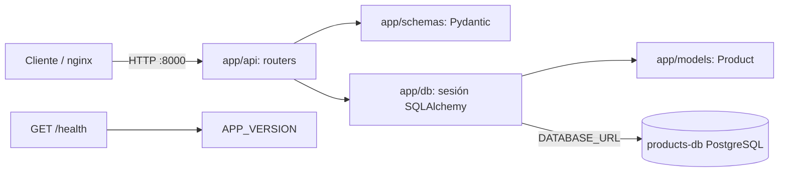

## Context

Ver `proposal.md` (Why). `products-service/` no existe aún; el repo solo tiene el harness. `AGENTS.md` fija la estructura Python (`api/`, `models/`, `schemas/`, `db/`), tipado completo, pytest y `ruff`. Python 3.12 y Docker están disponibles en la máquina; no hay PostgreSQL local, por lo que los tests no pueden depender de ella.

## Goals / Non-Goals

**Goals**
- API mínima del catálogo y `GET /health` con configuración solo por entorno.
- Tests rápidos y herméticos, sin base de datos externa.
- Imagen pequeña, multi-stage y sin root.

**Non-Goals**
- Migraciones (Alembic), autenticación, `PUT/DELETE`, paginación.
- Manifiestos de Kubernetes y `docker-compose.yml` (changes 3 y 5).
- Prueba contra PostgreSQL real dentro de la suite automática.

## Decisions

1. **Estructura `app/{api,models,schemas,db}` + `app/main.py` + `app/config.py`.** Es la convención de `AGENTS.md`; separa HTTP, validación y persistencia.
2. **SQLAlchemy 2.x síncrono con `psycopg` (v3).** Es suficiente para el volumen del proyecto y evita la complejidad de async; `psycopg[binary]` no necesita compilar en la imagen. URL con esquema `postgresql+psycopg://`.
3. **Creación de tabla con `Base.metadata.create_all` en el evento `lifespan`.** Lo pide el requisito y evita Alembic. Alternativa descartada: migraciones, que son excesivas para una tabla.
4. **Siembra solo si `count(*) == 0`.** Hace el arranque idempotente ante reinicios del pod.
5. **`price` como `Numeric(10, 2)` y `Decimal` en Pydantic (`gt=0`); `stock` entero `ge=0`; `name` con `min_length=1`.** Evita errores de coma flotante en dinero. La serialización devuelve número JSON.
6. **`created_at` con `server_default=func.now()` y zona horaria.** La base asigna la fecha; el servicio no la acepta del cliente.
7. **Errores en español:** 404 `{"detail": "Producto no encontrado"}`; los 422 los genera FastAPI/Pydantic con su formato estándar (mensajes de campo en inglés de Pydantic; se acepta, ya que el texto propio del servicio sí está en español).
8. **`GET /health` no toca la base de datos.** Es la probe de Kubernetes; que la BD tarde no debe reiniciar el pod en bucle. `version` viene de `APP_VERSION` con valor por defecto `dev`.
9. **`config.py` lee `DATABASE_URL` y falla al importar con mensaje en español si falta.** 12-factor y fallo rápido, sin valor por defecto que apunte a una base real.
10. **Tests con SQLite en memoria** mediante override de la dependencia de sesión (`StaticPool`) y `TestClient`. Son rápidos y no requieren Docker; el comportamiento específico de PostgreSQL se valida a mano con Docker (tarea de verificación), no en la suite.
11. **Dockerfile multi-stage:** etapa `builder` instala dependencias en un venv; etapa final `python:3.12-slim` copia el venv y `app/`, crea usuario `app` (uid 10001), `EXPOSE 8000` y arranca con `uvicorn app.main:app --host 0.0.0.0 --port 8000`.
12. **Calidad:** `ruff check` y `ruff format`, tipado completo. Dependencias fijadas en `requirements.txt`; las de desarrollo (`pytest`, `httpx`, `ruff`) en `requirements-dev.txt`, para que la imagen no las incluya.
13. **Logs en español** con el módulo `logging` (arranque, siembra, errores).

## Risks / Trade-offs

- [SQLite en tests oculta diferencias con PostgreSQL] → verificación manual con un contenedor `postgres` y `docker run` del servicio antes de cerrar el change.
- [`create_all` no migra esquemas existentes] → aceptable en esta fase; si el modelo cambia habrá que recrear la base o introducir Alembic en otro change.
- [Mensajes 422 de Pydantic en inglés] → documentado; traducirlos queda fuera de alcance.
- [El servicio falla al arrancar si la BD aún no responde] → en Kubernetes el pod se reinicia; se añade un reintento corto de conexión al arrancar (3 intentos, 2 s) para el caso de `docker compose` donde ambos suben a la vez.
- [`python3-venv` puede faltar en la máquina] → si `python3 -m venv` falla, se avisa al usuario en lugar de instalar paquetes del sistema.

## Migration Plan

No aplica (servicio nuevo). Rollback: borrar `products-service/` y revertir `feature_list.json` y `progress.md`.
