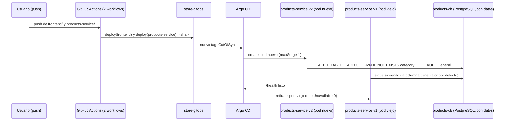

## Context

Ver `proposal.md` (Why). Estado real comprobado:

- **Despliegue v1** en AWS: los 3 Deployments usan el tag `0688166`, con 1 réplica cada uno y `RollingUpdate` con `maxSurge: 1` y `maxUnavailable: 0`. La tabla `products` de `products-db` (PostgreSQL 16 en un StatefulSet con PVC `gp3`) la creó `Base.metadata.create_all` con las columnas `id`, `name`, `price`, `stock` y `created_at`, y tiene los 3 productos sembrados.
- **`products-service`:** `init_db` (en `app/db/session.py`) ejecuta `create_all` y la siembra dentro de un bucle con reintentos. `create_all` crea tablas que faltan, pero **no modifica** las existentes: una columna nueva en el modelo no aparece en la base de AWS. El modelo es `Product` (`app/models/product.py`), los esquemas son `ProductCreate` y `ProductRead` y los tests usan SQLite en memoria.
- **Frontend:** el shell (`app-shell.html`) ya reserva `
` (oculto con `:empty`) y la tabla de productos usa un `<th>` por columna.
- **CI/GitOps:** un push que toque `frontend/` y `products-service/` lanza dos workflows en paralelo; cada uno publica su imagen y hace un commit `deploy(<servicio>): <sha>` en `store-gitops` (los `update-gitops` se serializan), y Argo CD hace el rolling update. `APP_VERSION` sigue al tag, así que el pie de página mostrará los SHA nuevos.

## Goals / Non-Goals

**Goals**
- Un cambio visible (banner y columna "Categoría") que recorra todo el flujo GitOps.
- Una migración real, segura sobre la base de AWS que ya tiene datos, idempotente y probada contra PostgreSQL.
- Compatibilidad entre versiones durante el rolling update y ante un rollback.

**Non-Goals**
- Alembic u otro framework de migraciones, categorías como entidad, edición de productos y rellenar categorías a los productos existentes.
- Hacer `git push` (lo hará el usuario grabando el video) o tocar `store-gitops` a mano.

## Decisiones

1. **Columna `category`:** `VARCHAR(100) NOT NULL DEFAULT 'General'`. El modelo la declara con `server_default="General"` para que `create_all` cree la misma forma en bases nuevas y la migración deje igual a las existentes. El valor por defecto es lo que hace seguro el rolling update: el pod viejo inserta sin `category` y la base completa `General`.
2. **Migración al arrancar en `app/db/migrations.py`** (`ensure_category_column(engine)`), llamada desde `init_db` justo después de `create_all` y dentro del mismo bucle de reintentos. En PostgreSQL ejecuta `ALTER TABLE products ADD COLUMN IF NOT EXISTS category VARCHAR(100) NOT NULL DEFAULT 'General'`: es idempotente, no falla si dos pods arrancan a la vez y, con un valor por defecto constante, es una operación de solo metadatos (sin reescribir la tabla) en PostgreSQL 11 o superior. En otros motores (SQLite, solo en tests) consulta las columnas con el inspector y añade la que falta, porque SQLite no admite `IF NOT EXISTS` en `ADD COLUMN`. Se registra en español cuando la columna faltaba. Alternativa descartada: Alembic, excesivo para una columna y con más piezas que mantener.
3. **Migración antes de servir tráfico:** corre en el arranque (lifespan), así que `/health` del pod nuevo no responde hasta que termina. Si falla, el pod entra en `CrashLoopBackOff` y, como `maxUnavailable: 0`, el pod viejo sigue sirviendo y el rolling update se detiene sin corte.
4. **API:** `ProductCreate.category` es opcional (`str | None`), se recorta (`strip`) y, si se envía, debe tener de 1 a 100 caracteres (si no, 422); si se omite no se pasa a la base y rige el valor por defecto. `ProductRead.category` es `str`. Una categoría de solo espacios se trata como inválida (422), no como `General`, para no ocultar un error del cliente.
5. **Siembra:** los 3 productos de una instalación nueva llevan categoría (`Periféricos`, `Periféricos` y `Monitores`). Los productos existentes en AWS se quedan en `General` (sin rellenar datos): es lo que pidió el usuario y evita tocar datos por nombre.
6. **Frontend:** `Product.category` es opcional en la interfaz para tolerar un servicio todavía en v1; la tabla pone "Categoría" tras "Nombre" y muestra `—` cuando falta (así no importa el orden en que se despliegue cada componente). El formulario añade un campo "Categoría" opcional que se omite del cuerpo si está vacío.
7. **Banner:** nuevo componente `shared/release-banner` (`app-release-banner`, `role="status"`) con el texto fijo "Versión 2 - desplegada con GitOps", dentro del `.banner-slot` del shell. El texto va en una constante del componente para que sea fácil de cambiar en una futura demo. Estilo con las variables CSS del proyecto y buen contraste.
8. **Pruebas:**
   - *Unitarias* (SQLite en memoria): API con `category` (listado, detalle, alta con y sin categoría, categoría inválida) y migración (tabla creada con el DDL de la v1, con filas; se verifica la columna, `General` en las filas existentes, datos intactos, segunda ejecución sin cambios y siembra sin duplicar).
   - *En local contra PostgreSQL real* (la que pidió el usuario): se construye la imagen **v1** desde el commit `0688166` (`git archive` a un directorio temporal), se arranca PostgreSQL, la v1 crea la tabla y se siembran y crean productos; se detiene; se arranca la **v2** contra la misma base y se comprueba que la columna aparece, que los datos se conservan con `General`, que un segundo arranque no cambia nada y que la v1 vuelve a funcionar sobre la base migrada.
   - *Frontend* (Vitest): columna y encabezado, celda sin categoría (`—`), alta con y sin categoría, y banner en ambas vistas.
9. **Sin cambios manuales en `store-gitops`:** la CI actualizará los dos tags. Los commits de este change, y el push, los hace el usuario.
10. **Capacidad:** no cambian pods ni requests de memoria; `scripts/check-capacity.py` debe seguir dando 17 de 22 pods.

## Riesgos / Trade-offs

- [SQLite en los tests no ejecuta la misma sentencia que PostgreSQL] → el camino de PostgreSQL se prueba en Docker con la base v1 real, y los tests unitarios cubren la lógica del inspector.
- [El `ALTER` toma un bloqueo breve sobre `products` mientras el pod viejo sirve] → con un valor por defecto constante es solo metadatos y dura milisegundos; la tabla tiene pocas filas.
- [Si la migración falla, el pod nuevo no arranca] → `maxUnavailable: 0` mantiene el pod viejo sirviendo; el error queda en los logs en español.
- [Frontend v2 desplegado antes que `products-service` v2] → la tabla muestra `—` en la categoría, sin errores.
- [Los productos existentes muestran `General`] → es lo pedido; los nuevos pueden llevar categoría desde el formulario durante la demo.
- [Rollback a la v1] → la columna extra no molesta a la v1 (tiene valor por defecto), así que revertir el commit de gitops basta.
- [Dos workflows a la vez] → sus `update-gitops` están serializados y reintentan con `pull --rebase`.
- [Categoría de texto libre] → validación de longitud; sin catálogo de categorías.

## Plan de migración

Orden de la demo (lo hace el usuario): push de `store-app` → los dos workflows publican las imágenes y actualizan `store-gitops` → Argo CD pasa de `OutOfSync` a `Synced` → rolling update de `frontend` y `products-service` (el nuevo pod migra la base) → el navegador muestra el banner, la columna "Categoría" y los SHA nuevos en el pie. Rollback: `git revert` del commit de la CI en `store-gitops` (Argo CD vuelve a la v1) o de este change en `store-app`; la columna `category` puede quedarse en la base.

## Preguntas abiertas

- Ninguna que cambie los specs.
